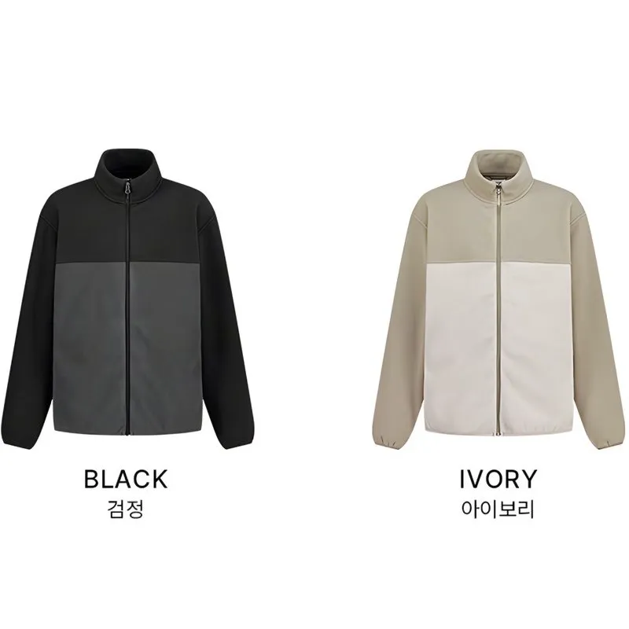

# B2BT (비투비티) Design System — 홈 v10 기준

> **이 파일을 읽는 AI 에이전트에게.** 하위 페이지를 만들 때는 이 파일이 유일한 기준이다.
> 1. YAML 토큰 값이 정답이다. 토큰에 없는 색·크기·간격을 새로 만들지 않는다.
> 2. 헤더·푸터·플로팅 요소는 **새로 짜지 말고 `index.html`에서 그대로 복사한다**([페이지 골격](#page-shell-하위-페이지-골격) 참고).
> 3. 기존 클래스가 있으면 기존 클래스를 쓴다. 홈에 없는 컴포넌트는 [하위 페이지 컴포넌트](#subpage-components-하위-페이지-전용-파생-규칙)에 적힌 규칙만 쓴다.
> 4. 값은 데스크톱(1440) / 모바일(≤768) 두 벌로 적었다. 모바일 값이 따로 없으면 데스크톱 값을 그대로 쓴다.
> 5. "(파생)"이라고 표시된 항목은 홈에 없어서 홈의 규칙으로부터 정한 값이다. 나머지는 모두 실측값이다.

## Overview

**브랜드**: 비투비티(B2BT). 주식회사 노을상사의 B2B 쇼핑몰이고, 기업 단체복·작업복·협력 브랜드(K2, EIDER, T-BUC 등 9곳) 상품과 맞춤 작업복을 판다. 결제보다는 **장바구니 → 견적문의** 흐름이 핵심이다(가격 대신 "견적문의"가 붙는 상품이 있다).

**인상**: 깔끔한 패션 커머스. 흰 바탕에 검정 잉크를 쓰고, 상품 사진(회색 스튜디오 배경)이 화면을 이끈다. 장식은 거의 없다.

- **흑백이 기본이고 파랑은 포인트로만 쓴다.** 선택 상태, 주요 버튼, 헤더 밑줄은 검정이다. 파랑(`#3182F6`)은 랭킹 1~3위 표식, 왕관 표식, 모바일 하단 "견적문의", 장바구니 견적 버튼, 숫자 강조, 포커스 링에만 쓴다.
- **모서리 규칙은 두 가지다.** 버튼·탭·조작 버튼은 알약(999px)이나 원이고, 사진·배너·카드·팝업은 16px(폰 사진은 14px)이다.
- **그림자는 "떠 있는 것"에만 준다.** 상품 카드에는 그림자가 없다. 구역은 회색 바탕(`#F5F5F6`)과 1px 선으로 나눈다.
- **제목은 '앞말(가늘게) + 이름(굵게)' 두 덩어리로 쓴다.** 예: "겨울을 책임지는 **겨울 아우터**". 영문 라벨(EYEBROW)은 v10에서 없앴으니 쓰지 않는다.
- **밀도**: 상품 목록은 촘촘하게(4열), 섹션 사이는 넉넉하게(120px) 둔다.

**문구 톤**: 한국어 평서문("~습니다", "~하세요")을 쓴다. 짧고 사실만 적으며, 과장·감탄·이모지는 쓰지 않는다. 수치에는 기준을 함께 적는다(예: "번호는 2026-11-11 진열 순서입니다."). 연출(AI) 사진 위에는 반드시 "연출 이미지입니다."를 붙인다. 확인되지 않은 수치나 주장(최대·최초·만족도 % 등)은 만들지 않는다.

## Colors

토큰 이름은 YAML의 `colors.*`이고, 오른쪽은 실제 CSS 변수다(이미 로드된 CSS에 정의되어 있으니 새 CSS에서는 **변수로 참조**한다).

| 역할 | 토큰 | 값 | CSS 변수 | 쓰는 곳 |
|---|---|---|---|---|
| 본문 잉크 | `primary` | `#0E0E10` | `--ink` | `#main` 기본 글자, 상품명, 가격, `.bt--ink`, 토스트, 장바구니 FAB |
| 순검정 | `black` | `#000000` | `--v9-ink` | 헤더 글자·밑줄 선, 위 띠 바탕, 선택된 알약 탭, `.pbtn` 테두리, `.hq`, 제목 이름(`.tt__key`) |
| 잉크(소프트) | `ink-soft` | `#1B1B1F` | `--ds-ink` | `body` 기본색, 필터칩 선택, 별점 |
| 강조 | `accent` | `#3182F6` | `--ds-accent`, `--accent` | 위의 포인트 용도만, `:focus-visible` 외곽선 |
| 강조 글자 | `accent-text` | `#1B64DA` | `--ds-accent-text`, `--accent-text` | 흰 바탕 위의 파란 글자(후기 개수, 착용 상품 분류) |
| 강조 옅은 면 | `accent-soft` | `#E8F3FF` | `--ds-accent-soft` | 왕관 원 바탕 |
| 섹션 설명 | `text-desc` | `#474747` | — | `.sh__d` |
| 제목 앞말 | `text-pre` | `#55545A` | — | `.tt__pre`(PC), 필터칩 글자 |
| 보조 글자 | `text-sub` | `#6B6B70` | `--v9-sub` | `.tt__pre`(폰), 후기 품목, 태그칩 |
| 상품 정보 | `text-body` | `#5C5A61` | `--site-body` | `.pc__meta`(사이즈·색상) |
| 흐린 글자 | `text-mute` | `#9A979E` | `--site-muted` | `.pc__cat`(분류). 본문에 쓰지 않는다 |
| 비선택 탭 | `text-tab` | `#8B8B90` | — | `.bh__tab` 비선택 |
| 메뉴 글자 | `text-menu` | `#363636` | `--v9-text` | 메가메뉴 하위 링크 |
| 긴 글 | `text-review` | `#2A2A2E` | — | 후기 본문 같은 긴 글 |
| 선 | `line` | `#DEDEE2` | `--v9-line` | 구분선, 로고 칸 테두리 |
| 선(옅음) | `line-soft` | `#DCDCDF` | `--line` | 진행 막대 바탕, 목록 구분 |
| 선(진함) | `line-strong` | `#C8C8CC` | `--line-2` | 수량 조절, 보조 버튼 테두리, 입력칸(파생) |
| 바탕 | `surface` | `#FFFFFF` | `--ds-bg`, `--paper` | 페이지·카드 |
| 회색 구역 | `surface-tint` | `#F5F5F6` | — | `.psec--tint`, 구매 후기 구역 |
| 상품 사진 칸 | `surface-media` | `#EDEDEF` | — | `.pc__media` 로딩 전 바탕 |
| 스튜디오 | `surface-studio` | `#F2F2F2` | `--studio` | 상품 사진 배경색과 같음(누끼처럼 보이게) |
| 칩 바탕 | `surface-chip` | `#F1F1F3` | — | 태그칩, 닫기 버튼 |
| 다크 | `dark` | `#0B0B0D` | `--dark` | 사진 배너 로딩 전 바탕 |
| 푸터 | `footer` 외 | `#1A1A1A` / 선 `#2C2C30` / 글 `#9A979E` / 링크 `#B7B7B7` / 메타 `#8A8A8F` | `--site-footer` | 푸터 전용 |
| 카카오 | `kakao` | `#FEE500` / 글 `#191919` | — | 카카오톡 상담 버튼만 |

**딤(오버레이)**: 영상 팝업 `rgba(6,7,10,.86)`, 패널 팝업 `rgba(6,7,10,.62)`, 전체 메뉴 `rgba(0,0,0,.36)`. 사진 위 그라데이션 `linear-gradient(0deg, rgba(8,9,12,.42) 0%, transparent 28%)`(아래쪽 어둡게), 글이 올라가는 쪽은 `linear-gradient(90deg, rgba(8,9,12,.7) 0%, rgba(8,9,12,.3) 34%, transparent 58%)`.

**강조색 전환**: `<html data-accent="blue">`가 기본값이다. 강조색은 반드시 `var(--accent)` / `var(--ds-accent)`로 참조해야 한다(`red` 세트로 바꿔 검수하는 기능이 있다). 파랑 hex를 직접 쓰지 않는다.

## Typography

**글꼴**
- 한글·본문: `Pretendard Variable`(CDN `pretendard@v1.3.9` variable dynamic-subset). 스택은 `Pretendard,"Pretendard Variable",-apple-system,"Apple SD Gothic Neo","Malgun Gothic",sans-serif`(`--ds-font`)이다.
- 영문 숫자 표식: `Barlow Condensed` 600/700/800(`--f-en`). 순위 번호, 배너 번호, 빠른 보기 분류(대문자)에만 쓴다.
- 고정폭: `JetBrains Mono` 400/500(`--f-mono`). 수량 숫자에만 쓴다.
- 전역 설정: `word-break: keep-all`, `-webkit-font-smoothing: antialiased`. 제목에는 `text-wrap: balance`를 쓴다. 숫자(가격·전화·수량)에는 `.num` 클래스(`font-variant-numeric: tabular-nums`)를 붙인다.

**글자 단계** (PC 1440 / 폰 ≤768. 실측값)

| 이름 | PC | 폰 | 굵기 | 자간 | 색 | 클래스 |
|---|---|---|---|---|---|---|
| 페이지 제목 H1 (파생) | 32 / 1.3 | 24 / 1.35 | 700 | -0.025em | `black` | `.sub-head__t` |
| 섹션 제목 | 26 / 1.35 | 20 / 1.4 | 600 | -0.02em | — | `.vh__t`, `.sh__t` |
| └ 앞말 | 같은 크기, 400 | **블록**, 14.5 / 22, 500 | | -0.01em(폰) | `text-pre` → 폰 `text-sub` | `.tt__pre` |
| └ 이름 | 같은 크기, 700 | **블록**, 22 / 30, 700 | | | `black` | `.tt__key` |
| 섹션 설명 | 15 / 1.75 | 14 / 1.7 | 400 | 0 | `text-desc` | `.sh__d` |
| 팝업 제목 | 30 / 1.22 | 23 | 800 | -0.045em | `primary` | `.qv__name` |
| 확인창 제목 | 22 / 1.35 | 22 | 800 | -0.04em | `primary` | `.rc__t` |
| 패널 제목 | 20 / 28 | 18 | 700 | -0.02em | `black` | `.rva__t` |
| GNB 메뉴 | 16 / 1 | — | 700 | -0.01em | `black` | `.bz__link` |
| 상품명 | 17 / 24 | 15 / 22 | 800 | -0.02em | `primary` | `.pc__name` (랭킹 16/23, 큰 카드 20/28) |
| 상품 분류 | 12 / 18 | 12 / 18 | 700 | 0 | `text-mute` | `.pc__cat` |
| 상품 정보 | 14 / 21 | 13 / 19 | 400 | 0 | `text-body` | `.pc__meta` |
| 가격 | 17 / 24 | 15.5 / 22 | 800 | 0 | `primary` | `.pc__price.num` |
| 본문 | 15 / 1.75 | 14.5 / 1.75 | 400 | -0.01em | `text-review` 또는 `text-desc` | `.rv__text` |
| 작은 본문 | 14 / 22 | 14 / 22 | 400 | 0 | `text-menu` | 메뉴, 표, 폼 라벨 |
| 캡션·법적 고지 | 13 / 20 | 13 / 20 | 400 | 0 | `footer-meta` / `text-sub` | `.ft__lines` |
| 사진 주석 | 11.5 / 16 | 11 | 400 | 0 | `rgba(255,255,255,.8)` | `.pb__note`, `.fd__note` |
| 버튼 | 15~16 / 1 | 15 | 700 | 0 | — | `.bt` |
| 보조 버튼 | 14 | 14 | 600 | 0 | `black` | `.pbtn` |
| 텍스트 링크 | 14 / 22 | 13 | 700 | 0 | `primary` | `.lnk` |
| 탭(알약) | 15 | 14 | 500 → 선택 700 | -0.01em | `text-tab` → 흰색 | `.bh__tab` |
| 배너 제목 | ≈52(1440, clamp) / 1.22 | 30 | 앞말 400 + 이름 700 | -0.02em | 흰색 | `.ss__t` |

**규칙**: 섹션 제목에 800을 쓰지 않는다(v10에서 600으로 낮췄다). 800은 상품명·가격·팝업 제목에만 쓴다. `letter-spacing`은 em 단위로 적는다.

## Layout

**본문 틀** (`#main`이 변수를 다시 정의한다. 하위 페이지도 반드시 `<main id="main">`을 쓴다)
```css
#main{--cw:1280px;--gut:max(clamp(20px,5.5vw,80px),(100vw - var(--cw)) / 2);--sec:120px}
@media (max-width:1023px){ #main{--sec:96px} }
@media (max-width:768px){ #main{--sec:72px} }
.wrap{margin-inline:var(--gut)}   /* 본문 내용은 항상 .wrap 안에 */
```
- 측정값: 1440 → 양옆 80px·폭 1280 / 1024 → 56px / 768 → 42px / 390 → 21.45px·폭 347px.
- 헤더·푸터는 `--cw:1400px`(양옆 79.2px @1440)이라 본문보다 조금 넓다. 정상이니 맞추지 않는다.
- 회색 구역·사진 배너만 화면 끝까지 깔리고, 글과 상품은 항상 `.wrap` 안에 둔다. 폰에서 사진 배너는 화면 끝까지 붙는다(모서리 0).

**세로 리듬**
| 항목 | PC | ≤1023 | ≤768 |
|---|---|---|---|
| 섹션 위 여백 `padding-top:var(--sec)` | 120 | 96 | 72 |
| 히어로 바로 다음 섹션 | 72 | — | 56 |
| 회색 구역(`.psec--tint`, `.rv`) | 위아래 120 + margin-top 120 | 96 | 72 |
| 섹션 제목 → 내용 | 28 | — | 16 |
| 상품 격자 → "전체 보기" 버튼 | 48 | — | 32 (후기는 40 / 24) |
| 마지막 섹션 아래 | `padding-bottom:var(--sec)` | | |

**격자**
| 이름 | PC | ≤1024 | ≤768 | ≤600 |
|---|---|---|---|---|
| 상품 `.pgrid` | 4열, gap 48 20 | 3열 | 2열, gap 32 12 (`html[data-cols="1"]`이면 1열, gap 36) | 2열 |
| 큰 카드 포함 `.pgrid--feat` | 첫 카드가 2×2 | 4열 유지 | 첫 카드 전체 폭 | |
| 후기 카드 `.rv__list` | 3열, gap 20 | 2열 | 가로 스크롤, 카드 84%, gap 12 | |
| 가로 레일 `.md__rail` | 카드 폭 = (폭-48)/4.25, gap 16 | | 카드 62vw, gap 10, scroll-snap | |

**중단점**: `1100`(메가메뉴 사진 숨김, 헤더 축소) · `1024/1023`(격자 3열, `--sec` 96) · `900`(헤더 한 번 더 축소) · **`768`(폰 전환: `.hd` → `.mh`, 하단 상담 바 표시, 우측 플로팅 숨김)** · `600`. 미디어쿼리는 이 값만 쓴다(`max-width:768px` / `min-width:769px`).

**헤더 높이**: 위 띠 36px(폰 40) + 헤더 72px(폰 60) = `--site-head-h` 108px(폰 100). sticky 요소의 `top`은 `calc(var(--site-head-h) + 10px)`이다(스크롤을 내려 헤더가 숨으면 `html.is-head-off`가 붙고 `--bh-top:0`이 된다).

**z-index 순서**(실측): sticky 탭 줄 40 · 우측 상담 150 · 장바구니 FAB 160 · 폰 하단 바 200 · 모바일 서랍 300 · 담당자 카드 450 · 팝업(`.vm`, `.rva`) 600 · 토스트 620.

## Elevation & Depth

기본은 평면이다. 위계는 **회색 구역 바탕 · 1px 선 · 사진 크기**로 나타낸다. 그림자는 떠 있는 요소에만 쓰고, 쓸 때는 아래 값 중에서만 고른다.

| 이름 | 값 | 쓰는 곳 |
|---|---|---|
| 떠 있는 알약 줄 | `0 0 0 1px rgba(14,14,16,.08), 0 14px 34px -14px rgba(14,14,16,.36)` | `.bh__in`(sticky 탭) |
| 카드(아주 옅게) | `0 1px 2px rgba(14,14,16,.04)` | 후기 카드 |
| 사진 위 원형 버튼 | `0 4px 14px rgba(20,24,40,.14)` | `.act` |
| 플로팅 버튼 | `0 8px 24px rgba(20,24,40,.28)` | `.bagfab` |
| 상담 버튼 | `0 2px 8px rgba(0,0,0,.12)` | `.side-cs__btn` |
| 안내 카드 | `0 0 0 1px #DCDCDF, 0 18px 44px rgba(14,14,16,.2)` | `.mg` |
| 사진 위 정보 칸 | `0 22px 46px -18px rgba(0,0,0,.6)` | `.pbt` |
| 팝업 | `0 40px 90px -30px rgba(0,0,0,.6)` (영상 .8) | `.rva__panel`, `.vm__box` |
| 토스트 | `0 12px 30px rgba(0,0,0,.25)` | `.toast` |

**테두리 대신 inset 그림자**: 선 버튼과 화살표는 `box-shadow: inset 0 0 0 1px var(--ink)`로 그린다(크기가 변하지 않는다). `.pbtn`만 실제 `border:1px solid #000`을 쓴다.

**흰 바탕 배경 효과**: 홈 흰 섹션 뒤의 옅은 하늘색 그라데이션(`.bgx`, `js/bgfx.js`, `data-bg`)은 **검수용이고 아직 확정되지 않았다.** 하위 페이지에는 넣지 않고 바탕을 순백으로 둔다.

## Shapes

| 토큰 | 값 | 쓰는 곳 |
|---|---|---|
| `rounded.full` | 999px / 50% | 모든 버튼(`.bt`, `.pbtn`, `.hq`), 탭, 칩, 원형 아이콘 버튼, 순위 표식 |
| `rounded.xl` | **16px** | 상품 사진 칸, 배너, 후기 카드, 팝업(`.qv__box`, `.rc__box`), 메가메뉴 사진 |
| `rounded.lg` | 14px | 폰 상품 사진 칸, 크게 보기 사진 |
| `rounded.md` | 12px | 브랜드 로고 칸, 아바타, 입력칸(파생) |
| `rounded.sm` | 10px | 사진 위 정보 칸의 작은 썸네일 |
| `rounded.xxl` | 20px | 큰 패널 팝업(`.rva__panel`) |
| `rounded.none` | 0 | 폰에서 화면 끝까지 붙는 배너, 화면 가득 패널, 토스트, 수량 조절, 위 띠 |

**규칙**: 하나의 화면 안에서 사진은 16px, 조작 요소는 알약 하나로 통일한다. 8px·6px·4px 모서리는 쓰지 않는다.

## Components

모든 컴포넌트 CSS는 이미 로드되는 파일 안에 있다. **클래스를 그대로 쓰고, 마크업 구조를 바꾸지 않는다**(선택자가 `.v9 .pc__name`, `.v10 .vh__t`처럼 `#main`의 클래스 사슬에 묶여 있다).

### 섹션 제목 (왼쪽 정렬 · 오른쪽 링크)
```html
<header class="vh vh--row">
  <div><h2 class="vh__t" id="xxTitle"><span class="tt__pre">단체로 맞추기 좋은</span> <span class="tt__key">후드·맨투맨</span></h2></div>
  <div class="vh__r"><a class="lnk" href="#" data-href="brand.php">전체 보기 <i aria-hidden="true">→</i></a></div>
</header>
```
- 가운데 정렬 + 설명 문장이 필요하면 `<header class="sh sh--c">` + `<h2 class="sh__t">` + `<p class="sh__d">`를 쓴다.
- 앞말(`.tt__pre`)은 짧은 수식어(6~10자)로, 이름(`.tt__key`)은 명사로 쓴다. 폰에서는 두 줄로 자동으로 나뉜다.

### 버튼
| 종류 | 마크업 | 모양 |
|---|---|---|
| 주 버튼(검정) | `<a class="bt bt--ink"><span>장바구니 담기</span><i>{→svg}</i></a>` | 높이 60(기본) / 56(팝업·패널 안) / 54(배너 위) / 48(폰 배너), 글자 칸 `0 22px 0 28px`, 오른쪽 화살표 칸(너비 = 높이, 왼쪽 1px 흰 선 22%). hover: 아래에서 강조색이 차오르고(.5s) 화살표가 5px 이동 |
| 강조(파랑) | `.bt.bt--acc` | 한 화면에 하나만. 장바구니 → "구매 목록으로 견적 문의" |
| 흰색(사진 위) | `.bt.bt--wh` | 배너 위 CTA |
| 선 | `.bt.bt--line` | 주 버튼 옆의 보조 버튼(`inset 1px` 잉크) |
| 전체 보기(보조) | `<a class="pbtn" href="#" data-href="…">패딩 전체 보기</a>` | 높이 48, 좌우 28, 1px 검정 테두리, 흰 바탕. hover 시 검정 반전. **폰에서는 width:100%**. 섹션 아래 가운데 `.psec__more` 안에 둔다 |
| 헤더 견적 | `.hq` | 높이 36, 검정 알약. 헤더 전용 |
| 글자 링크 | `<a class="lnk">전체 보기 <i aria-hidden="true">→</i></a>` | 14/700, 1px 밑줄. hover 시 밑줄이 오른쪽으로 사라지고 화살표 4px 이동 |
| 화살표(원) | `<button class="arw" aria-label="다음 상품">{→svg}</button>` | 52 원, inset 1px 잉크, hover 잉크 반전, disabled 투명도 .28 |

화살표 svg: `<svg viewBox="0 0 24 24" fill="none" stroke="currentColor" stroke-width="2" stroke-linecap="round" stroke-linejoin="round" aria-hidden="true"><path d="M5 12h14M13 6l6 6-6 6"/></svg>`

### 알약 탭 줄 (분류·브랜드 고르기) — 하위 페이지의 기본 탭
```html
<div class="bh" data-bh aria-label="분류">
  <div class="bh__in"><div class="bh__scroll"><div class="bh__list" role="tablist">
    <button type="button" role="tab" class="bh__tab" aria-selected="true">패딩</button>
    <button type="button" role="tab" class="bh__tab" aria-selected="false">겨울조끼</button>
  </div></div></div>
</div>
```
- 가운데에 떠 있는 흰 알약(높이 56, 안쪽 여백 5, 그림자는 "떠 있는 알약 줄")이다. 선택 = 검정 바탕 + 흰 글자 700, 비선택 = `#8B8B90` 500.
- `position:sticky; top: calc(var(--bh-top) + 10px)`로 헤더 아래에 붙는다. 폰에서는 화면 폭에 맞추고(높이 48, 여백 4), 탭은 `flex:1 0 auto`, 글자 14, 좌우 15.
- `.v10` 사슬 안에서만 이 모양이 된다(`#main.v10`).

### 상품 카드 (`.pc`) — 정확한 마크업
```html
<article class="pc" data-key="c475">
  <div class="pc__media">
    
    <div class="pc__bars" aria-hidden="true"></div>
    <!-- 랭킹일 때만: <span class="pc__rank num"><span class="sr-only">순위 </span>1</span> -->
    <div class="pc__acts">
      <button type="button" class="act act--view" aria-label="빠른 보기">{눈 svg}</button>
      <button type="button" class="act act--like" aria-pressed="false" aria-label="관심상품">{하트 svg}</button>
      <button type="button" class="act act--cart" aria-label="장바구니 담기">{가방 svg}</button>
    </div>
    <div class="pc__sw"><span class="dot" style="--c:#111111"></span><span class="dot" style="--c:#1F2A44"></span></div>
  </div>
  <p class="pc__cat">패딩</p>
  <a class="pc__name" href="#" data-href="product.php?id=475"><span>방한 후드 패딩</span></a>
  <div class="pc__ms"><p class="pc__meta">85 ~ 115</p><p class="pc__meta">색상 3종</p></div>
  <p class="pc__price num">59,000원~</p>
</article>
```
- 가격이 없는 상품(협력 브랜드)은 가격 줄 대신 `<button type="button" class="pc__price pc__quote" aria-label="{상품명} 장바구니에 담아 견적 문의">견적문의 <i aria-hidden="true">+</i></button>`를 쓴다.
- 변형: `pc--slim`(색상 줄 없이 사진 위 색상 점만), `pc--feat`(큰 카드, `.pgrid--feat`의 첫 칸), `pc--worn`(분류 글자가 강조색).
- 사진은 1:1, 칸 바탕 `#EDEDEF`, 모서리 16(폰 14). hover 시 사진 `scale(1.035)`, 원형 액션 버튼(44, 폰 36)이 나타난다. 분류 → 이름 4 → 정보 6 → 가격 6 간격(폰 12/4/4/4).
- 순위 표식: 32 원, Barlow 17/700, `rgba(27,27,31,.86)`이고 1~3위는 `var(--accent)`이다(폰 28/15).
- 가격 표기: `59,000원~`(시작가 물결), `1만원대`. 분류 표기: `시즌 · 패딩`(가운데점 앞뒤 공백).

### 사진 배너
- 틀: `border-radius:16px; overflow:hidden; background:var(--dark)`. PC 비율 2.8:1(시즌 배너) 또는 높이 `clamp(440px,41.5vw,600px)`(파트너 배너)이고, 폰은 4:5에 화면 끝까지 붙인다(모서리 0).
- 글은 왼쪽 `clamp(28px,4.4vw,64px)` 안쪽에 두고, 제목 → 설명 14 → 버튼 24(폰 16) 순서로 쌓는다. 글 쪽에 90deg 어둠 그라데이션을 깐다.
- `<picture>`로 폰 사진(`-m.webp`)을 분리한다: `<source media="(max-width:768px)" srcset="…-m.webp" width="1000" height="1250">`.
- AI 연출 사진에는 `data-temp="ai"`를 붙이고 오른쪽 위에 `<p class="fd__note">연출 이미지입니다.</p>`를 둔다.

### 품목별 보기 (`.cg.cg--w`, 홈 겨울 아우터 다음)
- 흰 바탕 섹션. 위 간격 `--sec`, 아래 간격은 다음 회색 띠(`.psec--tint`)의 `margin-top`이 맡는다. 제목은 `.vh--row` 앞말 + 이름("티셔츠부터 모자까지 **품목별 보기**"), 오른쪽 `.vh__r`에 `.lnk` 두 개(단체복 · 작업복 전체 보기). 제목 → 조각 `clamp(24px,2.6vw,36px)`(폰 18).
- PC(901 이상): 세로 사진 조각 10개(`.cgs`)를 한 줄에 사이 6px, 높이 `clamp(420px,42vw,600px)`, 모서리 16. 고른 조각만 `flex-grow:5.4`로 넓어지고(.8s `--ease`) 컬러로, 나머지는 흑백·어둡게(`grayscale(.9) brightness(.6)`) 두고 이름을 세로쓰기 16/700으로 놓는다. 넓어진 조각은 왼쪽 아래에 이름(22~32/700) + "상품 보기 →". 마우스를 올리거나 초점이 가면 바뀌고, 터치 PC는 첫 누름으로 넓힌 뒤 두 번째 누름에 이동한다(`js/v10.js`).
- 폰·태블릿(900 이하): 옆으로 넘기는 4:5 카드(38vw, 600 이하 60vw), 이름을 늘 보인다. 조각 번호(01~10)와 영문 머리글은 쓰지 않는다. 사진 아래 오른쪽(폰 왼쪽)에 "연출 이미지입니다." 12/18 `#9A979E`. 원본 구조와 움직임은 `css/v8.css` 10번, 덮어쓰기는 `css/v10.css` 18번.

### 후기 카드 (`.rv__card`)
흰 카드(모서리 16, 그림자 아주 옅게)이고, 사진 묶음(3:2, 간격 3px) → 본문(여백 `20px 24px 24px`, 폰 `16px 18px 20px`) 순서다. 별점 15px `#1B1B1F` → 업체명 16/700 + `|` + 품목 13/500 `#6B6B70` → 글 15/1.75 `#2A2A2E`(`white-space:pre-line`).

### 팝업 · 패널 · 피드백
- **팝업 상자**: 흰 바탕, 모서리 16, 딤 위 가운데, 열릴 때 `translateY(18px) scale(.98)` → 원래 자리(.4~.5s `--ease`). 닫기 버튼은 44 원(`rgba(255,255,255,.92)`), hover 시 90도 회전. `role="dialog" aria-modal="true"` + 제목 `aria-labelledby`.
- **큰 패널**(`.rva__panel`): 최대 1240×920, 모서리 20, 바탕 `#F5F5F6`, 머리 흰색 + 아래 1px `#E9E9EC`. 폰에서는 화면 가득(모서리 0).
- **오른쪽 서랍**(`.bag__panel`): 폭 460(폰 100%).
- **토스트**: 검정 높이 48, 가운데 아래 36px, 왼쪽 글 + 오른쪽 구분선 뒤 동작 버튼. 모서리 0.
- **수량 조절**(`.qty`): 높이 40, inset 1px `#C8C8CC`, ± 버튼 40×40, 숫자 JetBrains Mono 14.

### 헤더 · 메뉴 · 푸터 (복사 전용)
- 위 띠 `.band`: 검정 36(폰 40), 13px(폰 12.5), 구분은 `/`(흰색 45%).
- PC 헤더 `.hd`: 흰 바탕 72, 아래 1px 검정 선, 로고 높이 40, 메뉴 16/700에 hover 시 아래 2px 검정 밑줄, 오른쪽에 `.hq` 견적문의 + 아이콘 44(svg 24, stroke 1.6).
- 폰 헤더 `.mh`: 60, 아래 inset 1px 검정, 아이콘 버튼 44(svg 30, stroke 1.5).
- 메가메뉴: 왼쪽 사진 280(4:5, 모서리 16) + 목록 5열. 제목 15/700, 링크 14/22 `#363636`, 개수 12 `#6B6B70`.
- 폰 하단 상담 바 `.mbar`: 60, 채팅상담 25% · 전화상담 25% · **견적문의 50% 파랑**. `body`에 `padding-bottom:60px`이 붙는다.
- PC 우측 플로팅 `.side-cs`: 카카오 52 원(`#FEE500`) + 맨 위로 52 원(흰 바탕, 1px `#D9D9DE`), right 24 / bottom 24.
- 푸터 `.ft`: `#1A1A1A`, 위아래 56/48(폰 40/32), 구획 사이는 1px `#2C2C30`. 정책 링크 → 사업부 4열(폰 1열) → 사업자 정보 + 고객센터 번호(22/800 흰색, 오른쪽 정렬) → 인증 로고(높이 26, 흰색 55%) → 회사 문구·저작권.

### 아이콘
인라인 SVG만 쓴다: `viewBox="0 0 24 24" fill="none" stroke="currentColor" stroke-linecap="round" stroke-linejoin="round" aria-hidden="true" focusable="false"`, `class="ic"`. 선 굵기는 PC 1.6, 폰·큰 아이콘 1.5, 화살표·닫기 2. 크기는 22~30이다. 닫기 path는 `M6 6l12 12M18 6 6 18`이다. 아이콘 폰트와 이모지는 쓰지 않는다.

### 모션
- 이징: `--ease: cubic-bezier(.22,.8,.2,1)`(대부분), `--ease-io: cubic-bezier(.65,0,.35,1)`(슬라이드 전환).
- 시간: 색 전환 .15~.25s, 밑줄·채움 .3~.5s, 사진 확대 .6~.9s.
- 홈의 스크롤 등장(`[data-rv]`, GSAP)은 `js/v10.js`가 있어야 동작한다. **하위 페이지에는 `data-rv`를 쓰지 않는다**(`html.v4-motion [data-rv]{opacity:0}` 때문에 4초 동안 안 보인다).
- 모든 움직임은 `@media (prefers-reduced-motion:reduce)`에서 꺼야 한다.

## Do's and Don'ts

**Do**
- 헤더·푸터·서랍·하단 바는 `index.html`에서 복사한다. 한 글자도 다시 쓰지 않는다.
- `<main id="main" class="v4 v5 v6 v7 v8 v9 v10 subp">`처럼 클래스 사슬을 그대로 둔다.
- 색·간격은 이미 있는 CSS 변수(`var(--ink)`, `var(--accent)`, `var(--gut)`, `var(--sec)`, `var(--ease)`)로 참조한다.
- 버튼·탭은 알약, 사진·카드는 16px로 쓴다.
- 탭·필터는 `.bh` 알약 줄이나 필터칩을 쓴다.
- 섹션 제목은 "앞말 + 이름" 구조로 쓴다.
- 숫자에는 `.num`, 가격에는 `원` / `원~`을 붙인다.
- 모든 이미지에 `width`·`height`를 적고, 첫 화면 밖 이미지는 `loading="lazy" decoding="async"`로 둔다.
- 링크는 홈과 같이 `href="#" data-href="파일.php?…"` 형식으로 쓴다(정적 시안이라 이동하지 않는다).
- `:focus-visible`(2px 강조색, offset 3px. 사진·어두운 바탕 위에서는 흰색)을 지운 채로 두지 않는다.
- 터치 대상은 44px 이상으로 만든다.

**Don't**
- 파랑을 큰 면이나 제목 색으로 쓰지 않는다(한 화면의 강조 버튼은 하나).
- 그림자를 상품 카드나 일반 상자에 주지 않는다.
- 새 hex·새 글자 크기·8px 같은 새 모서리를 만들지 않는다.
- 섹션 제목에 영문 라벨(EYEBROW)이나 800 굵기를 쓰지 않는다.
- `#000`과 `#0E0E10`을 섞어 쓰지 않는다. 헤더·탭·선택 상태·`.pbtn`은 `#000`, 본문 글·`.bt--ink`·토스트는 `#0E0E10`이다.
- `text-mute(#9A979E)`나 `text-tab(#8B8B90)`을 긴 본문에 쓰지 않는다(흰 바탕 대비가 4.5:1에 못 미쳐서 분류·비선택 탭 같은 짧은 보조 글자에만 쓴다).
- `js/v10.js`, `js/bgfx.js`, 검수용 배경 고르기(`.rvw`)를 하위 페이지에 넣지 않는다(홈 전용).
- 이모지·아이콘 폰트·외부 UI 라이브러리(부트스트랩, 테일윈드 등)를 쓰지 않는다.

## Page Shell (하위 페이지 골격)

파일 이름은 홈 링크의 php 이름을 `.html`로 바꿔 쓴다(예: `category.php` → `category.html`). 위치는 `index.html`과 같은 폴더다.

**만드는 방법**: 완성 HTML을 손으로 쓰지 않는다. 페이지마다 조각 하나(`tools/pages/<이름>.html`)에 본문만 쓰고 `python3 tools/build.py`를 돌리면, 빌드가 `index.html`에서 `<head>` 설정·헤더·서랍·푸터·하단 상담 바·우측 상담을 잘라 붙여 아래 골격의 완성 파일을 만든다. 조각 맨 위의 `<!--{…}-->` 머리에 제목·설명·요소 목록 절 이름(`sections`)·상태 목록(`states`)·추가 스크립트를 적는다. 같은 빌드가 `tools/css/*.css`를 합쳐 `css/sub.css`를 만들고(선택자 앞에 `.subp `를 자동으로 붙인다), 모든 페이지·상태 링크를 모은 `pages.html`을 만든다. 점검은 `python3 tools/check.py pages <이름>`(Chromium 1440·1024·768·390 + WebKit 1710·390에서 가로 스크롤·콘솔 오류·깨진 이미지·h1 개수·헤더/푸터 일치·CSS 순서)과 `python3 tools/check.py els <이름>`(요소 목록 대조)로 한다.

```html
<!DOCTYPE html>
<html lang="ko" data-accent="blue" data-claim="on">
<head>
<!-- ① index.html <head> 첫 <script> 블록(data-* 설정)을 그대로 복사 -->
<meta charset="utf-8">
<meta name="robots" content="noindex,nofollow">
<meta name="viewport" content="width=device-width, initial-scale=1, viewport-fit=cover">
<title>{페이지 이름} | 비투비티</title>
<meta name="description" content="{한 문장 설명}">
<link rel="icon" type="image/png" href="img/b2bt-v2-h56.png">
<link rel="preconnect" href="https://cdn.jsdelivr.net" crossorigin>
<link rel="stylesheet" href="https://cdn.jsdelivr.net/gh/orioncactus/pretendard@v1.3.9/dist/web/variable/pretendardvariable-dynamic-subset.min.css">
<link rel="stylesheet" href="css/ds-blue.css?v=20261116">
<link rel="stylesheet" href="css/site.css?v=20261116">
<link rel="preconnect" href="https://fonts.googleapis.com">
<link rel="preconnect" href="https://fonts.gstatic.com" crossorigin>
<link rel="stylesheet" href="https://fonts.googleapis.com/css2?family=Barlow+Condensed:wght@600;700;800&family=JetBrains+Mono:wght@400;500&display=swap">
<link rel="stylesheet" href="css/v4.css?v=20261116">
<link rel="stylesheet" href="css/v8-base.css?v=20261116">
<link rel="stylesheet" href="css/v8.css?v=20261116">
<link rel="stylesheet" href="css/ui-v8.css?v=20261116">
<link rel="stylesheet" href="css/v9.css?v=20261116">
<link rel="stylesheet" href="css/v10.css?v=20261116">
<link rel="stylesheet" href="css/sub.css?v=20261116">   <!-- 하위 페이지 공용. tools/css/*.css 를 빌드가 합친 파일 -->
<script src="js/site-v10.js?v=20261116" defer></script>
<script src="js/sub.js?v=20261117" defer></script>   <!-- 상태 보기·팝업·알림·양식 검사 -->
<script src="js/sub-{과제}.js?v=20261117" defer></script>   <!-- 페이지 전용(있을 때만) -->
</head>
<body>
<!-- ② index.html의 <header class="site-head v9h" id="siteHead"> ~ </header>,
        <div class="drawer-dim" …></div>, <div class="drawer" id="drawer" …> ~ </div> 를 그대로 복사 -->

<main id="main" class="v4 v5 v6 v7 v8 v9 v10 subp">
  <section class="sub-head">
    <div class="wrap">
      <nav class="crumb" aria-label="현재 위치"><a href="#" data-href="index.php">홈</a><span aria-hidden="true">/</span><a href="#" data-href="category.php">단체복</a><span aria-hidden="true">/</span><span aria-current="page">라운드 티셔츠</span></nav>
      <h1 class="sub-head__t">라운드 티셔츠</h1>
      <p class="sub-head__d">반팔·긴팔·아동용 라운드 티셔츠를 모았습니다.</p>
    </div>
  </section>
  <div class="wrap sub-body">…</div>   <!-- 본문. 묶음 사이는 .blk(64/44) · .blk-s(40/28) -->
</main>

<!-- ③ index.html의 <footer class="ft"> ~ </footer>, <nav class="mbar"> ~ </nav>, <div class="side-cs"> ~ </div> 를 그대로 복사 -->
</body>
</html>
```
- CSS 순서를 바꾸지 않는다. 뒤 파일이 앞 파일을 덮어쓰는 구조다(`ds-blue` → `site` → `v4` → `v8-base` → `v8` → `ui-v8` → `v9` → `v10` → `sub.css`).
- `main`의 클래스는 `subp`다. 홈 CSS에 이미 `.sub`가 있어서 겹치지 않게 이 이름을 쓴다.
- 현재 메뉴 강조가 필요하면 해당 `.bz`에 `is-open`을 쓰지 않는다(드롭다운이 열린다). 하위 페이지에서는 따로 강조하지 않는다.
- 따로 열리는 창(견적서 7종, 시안확인)은 조각 머리에 `"shell": "bare", "win": true`를 적는다. 사이트 헤더·푸터 대신 얇은 머리줄 `.win__bar`(로고 · 문서 이름 · 닫기 · 주요 버튼)를 쓰고 바탕은 `#F5F5F6`이다.
- 주문서·바로주문·주문 완료·카드 결제 처리는 `"nocs": true`로 빠른 상담(하단 상담 바·우측 상담)을 감춘다.
- `js/sub.js`는 홈에 없는 공통 요소(로그인 이름·로그아웃, 장바구니 수, 인기 검색어·진행 중 이벤트, 우측 상담 메뉴, 방문 기록 동의)를 실행 중에 붙인다. 홈에도 같은 요소를 넣으면 이 부분은 지운다.

## Subpage Components (하위 페이지 전용)

홈에 없는 부품이다. 값은 모두 위 토큰과 홈 CSS에 이미 있는 값에서 가져왔다. 원본은 `tools/css/00-base.css`(골격·안내·표·팝업) · `10-form.css`(양식) · `20-list.css`(상품 목록) · `95-icons.css`(아이콘)이고, `tools/build.py`가 이 조각들을 `css/sub.css` 한 파일로 합친다. 마크업 견본은 `kit.html`(부품 견본 페이지, 원본 `tools/pages/kit.html`)에 모두 있다. 새 페이지는 먼저 이 부품을 쓰고, 없을 때만 페이지 조각 CSS에 접두어를 붙여 만든다.

**하위 페이지에서만 쓰는 변수**(`#main.subp`에 정의): `--fg #000`(제목) · `--fg2 #474747`(본문) · `--fg3 #6B6B70`(보조) · `--ln #DEDEE2`(선) · `--tint #F5F5F6`(회색 바탕) · `--blk 64px / 폰 44px`(묶음 사이) · `--blk-s 40px / 폰 28px`(작은 묶음 사이). 본문 기본 15px / 1.7 / `#0E0E10`.

**홈 CSS에서 가져와 하위 페이지에서 처음 쓰는 값**: 입력 오류는 `site.css`의 red 강조 세트 세 값만 쓴다 — 선·아이콘 `#D10019`, 글자 `#B80016`, 옅은 바탕 `#FFF0F1`. 오류는 색만으로 알리지 않고 항상 문장을 함께 둔다. 검정 버튼 눌림 `#262626`(`v9.css .hq:hover`), 옅은 칸 바탕 `#EDEDEF`(`v10.css`). 이 밖의 hex는 새로 만들지 않는다. 알림(토스트)은 오류일 때도 검정 바탕 + 경고 아이콘이다(빨간 토스트를 쓰지 않는다).

| 부품 | 클래스 | 값 |
|---|---|---|
| 페이지 머리 | `.sub-head` > `.wrap` > `.crumb` + `h1.sub-head__t`(+`small`) + `p.sub-head__d` · 가운데 `.sub-head--c` · 오른쪽에 도구 `.sub-head--row` | 위 48(폰 40) · 경로 13/20 `--fg3`, 현재 위치 600 `#000` · 제목 32/700/1.3 -0.025em(폰 24/1.35) · 설명 15/1.75 `--fg2` 최대 640 |
| 본문 시작 | `.wrap.sub-body` · 좁은 열 `.wrap--760` `--560` `--440` | 머리 아래 40(폰 28) |
| 작은 제목 | `h2.st`(+`small`) · `.st--s` · 제목 줄 `.st-row` · 설명 `.sd` | 20/700/28 -0.02em · 17/24 · 설명 14/22 `--fg3` |
| 페이지 안 메뉴 | 알약 탭 `.stab`(`a[aria-current]` / `button[role=tab][aria-selected]`) · 가운데 `.stab--c` | `tab-pill` 값 그대로: 칸 46(폰 44) · 15/500 `#8B8B90`(폰 14) → 선택 `#000` 바탕 흰 글자 700. 칸들을 1px `--ln` 알약 줄(안쪽 4px)에 담는다. 넘치면 옆으로 민다 |
| 분류 고르기 | 홈의 떠 있는 알약 줄 `.bh`(구조는 `category.html`) | 홈 값 그대로 |
| 보조 버튼 | `.sb` + `--ink --line --gray --soft --acc` + 크기 `--s 36 / --m 44 / 기본 48 / --l 56` · `.sb--block` | 알약 · 14/600(`--l` 15/700). 폰에서 혼자 누르는 버튼은 44 이상 |
| 버튼 줄 | `.acts` `.acts--c` `.acts--end` · 양식 끝 `.form-acts` | 간격 8 |
| 상태 칩 | `.stag` + `--ink --acc --line --red` · 큰 것 `--l` | 높이 24(28) · 12/600 · 알약 · 기본 `#F1F1F3` 바탕 `#6B6B70` |
| 선 상자 | `.cbox` · 회색 `.cbox--tint` · 작은 것 `.cbox--s` | 안쪽 28(20) · 1px `--ln` · 16px |
| 안내 상자 | `.note`(+`.note__t` + `ul`) · 선 `.note--line` | 20/24 안쪽 · 회색 바탕 · 16px · 14/22 `--fg2` · 목록 점 3px |
| 한 줄 안내 | `.msg` · `.msg--err` · `.msg--ok` | 13/16 안쪽 · 16px · 오류 `#FFF0F1`/`#B80016` · 완료 `--accent-soft`/`--accent-text` |
| 빈 상태 | `.empty` > `.empty__ic` + `.empty__t` + `.empty__d` + `.acts` | 위아래 72 · 둥근 표식 52(회색) · 제목 17/700 · 설명 14/22 최대 420 |
| 한 가지 결과 화면 | `.gate` > `.smark` + `.gate__t` + `.gate__d` + `.gate__box` + `.acts` (`unsubscribe.html`) | 위 96 · 표식 52 원(파랑 옅은 바탕, `--ink --gray --red`) · 제목 24/700 · 설명 15/1.75 최대 440 |
| 정보 줄 | `dl.dl` > `div` > `dt` + `dd` · 작은 것 `.dl--sm` · 선 없음 `.dl--plain` | 위 1px 검정, 줄마다 1px `--ln` · 이름 칸 132(작은 것 96) · 14.5/22 |
| 표 | `table.tbl` · 폰에서 쌓기 `.tbl--stack`(`td[data-th]`) · 정렬 `.r` `.c` · 넘침 `.tbl-scroll` | 위 1px 검정 · 머리 회색 바탕 600 · 칸 16/12 · 14/22 `#363636` |
| 쪽 번호 | `.pager`(`SUBDATA.pager()`) | 44 원(폰은 칸이 많으면 폭만 줄어듦) · 현재 쪽 검정 바탕 흰 글자 · 위 48(폰 32) |
| 펼침 목록 | `.qlist` > `details` > `summary` + `.qlist__a` | 위 1px 검정 · 질문 16/600 · 꺾쇠가 180° 돈다 |
| 단계 표시 | `ol.stp` > `li.is-done / .is-on` > `b` + `span` | 순서를 알리는 작은 크기로만 쓴다(크게 장식하지 않는다) |
| 팝업 | `.pop` > `.pop__dim` + `.pop__box(--m 640 / --l 880 / --xl 1120)` > `.pop__head`(`.pop__t` + `.pop__x`) + `.pop__body` + `.pop__foot` · 가운데 확인형 `.pop--c` | 기본 폭 480 · 16px · 제목 20/700(폰 18) · 닫기 44 원 · 그림자 `0 40px 90px -30px rgba(0,0,0,.6)` |
| 옆 패널 | `.side` > `.side__dim` + `.side__panel` > `__head` `__body` `__foot` | 폭 480 · 오른쪽에서 들어온다 |
| 양식 | `fieldset.fset` > `legend.fset__t` · 2열 `.fgrid`(`.full`) · 1열 `.fstack` · 항목 `.fld` > `.fld__l`(`em` 필수) + 입력 + `.fld__help` + `.fld__msg--err/--ok` | 묶음 위 1px 검정, 묶음 사이 48 · 묶음 제목 18/700 · 칸 간격 24 20 · 라벨 14/600 |
| 입력 | `.inp` `.sel` `.txa` · 입력+버튼 `.inrow` · 주소 `.addr` · 비밀번호 `.pw` · 체크 `.chk` · 라디오 `.rdo` · 알약 선택 `.seg` · 카드 선택 `.opts` > `.opt` · 칩 `.fchips` > `.fchip` · 첨부 `.upl` + `.files` / `.thumbs` · 수량 `.qty` · 자동등록방지 `.cap` · 동의 `.agree` | 입력칸 높이 48 · 모서리 12(입력칸·작은 칸만) · 1px `#C8C8CC` → 포커스 강조색 + 3px `--accent-soft` · 오류 `#D10019` 테두리 + 아래 `#B80016` 문장 · 체크·라디오 20 원, 고르면 검정 · 카드 선택 16px |
| 따로 열리는 창 | `.win__bar`(로고 + 문서 이름 + 닫기) · `.win__body` | 사이트 헤더·푸터 없이 얇은 머리줄만 둔다 |
| 사진 표시 | 연출 사진 위 `.lhero__note`("연출 이미지입니다.") · 교체할 자리 `data-slot` · 견본 값 `data-sample` | |
| 아이콘 | `<i class="i i-이름" aria-hidden="true">` · 크기 `.i--14`~`.i--32`(기본 20) | 마스크 아이콘 62종(`95-icons.css`). 1.6px 선, 둥근 끝 |

**상태 보기**: 시안의 모든 상태는 주소 값으로 연다(`?state=empty`, `?state=guest`, `?tab=notice&state=empty`). `js/sub.js`가 `data-st="상태"`(그 상태에서만 보임), `data-st-not`(그 상태에서 숨김), `@member` / `@guest`, `data-open-st`(팝업 연 채로), `data-toast-st`, `data-err-st`, `data-ok-st`, `data-busy-st`를 처리한다. 상태 목록은 페이지 조각 머리의 `states`에 적고, `pages.html`(검수 목록)이 그 목록으로 링크를 만든다.

## 페이지 유형별 조립법

유형마다 레퍼런스 캡처를 보고 정한 구조다. 근거와 버린 후보는 `research/decisions/<유형>.md`, 캡처는 `research/refs/<유형>/`에 있다. 새 페이지는 가장 가까운 유형의 조립을 그대로 따른다. 모든 유형에 공통: 머리는 `.sub-head`(경로 → h1 → 설명 한 줄), 본문은 `.wrap.sub-body`, 버튼은 한 화면에 파란 것 하나까지, 빈 상태·오류·비로그인·처리 중·완료는 모두 주소 값(`?state=`)으로 볼 수 있게 만든다.

| 유형 | 페이지 | 조립 (위에서 아래, PC → 폰) | 결정 문서 |
|---|---|---|---|
| A. 상품 목록 | `category` `brand` `search` | 경로 → 분류 사진 배너(PC 높이 280 안팎 · 폰 3:2, 사진 위 "앞말 + 이름" h1과 견적문의 버튼. 사진이 여러 장이면 이전·다음과 진행 막대, 자동으로 넘기지 않음) → 세부 분류 `.bh`(헤더 아래 붙는 알약 줄) → 도구 줄(왼쪽 상품 수 · 필터 버튼 6개, 오른쪽 정렬 3개 글자) → 고른 필터 칩 → (작업복·브랜드 베스트 한 줄) → `.pgrid` 4/3/2열 `.pc` → `.pager`. 필터는 PC에서 버튼 아래 뜨는 상자(한 번에 한 종류, 초기화·적용), 폰에서 화면 가득 필터 모음(아래 `초기화 / N개 상품 보기` 고정). 브랜드는 `.bh--logo` + 형태 칩 묶음, 검색은 배너 없이 제목과 수만. 결과 없음은 격자 자리에 `.empty` + 다음 행동 | `list.md` |
| B. 상품 상세·구매 | `product` | PC 사진 5fr : 구매 6fr(사이 56, 사진은 붙어 따라옴) · 769~1099 2:3 · 폰 한 단. 구매 칸 순서(PC·폰 같음): 분류 → 상품명 h1(28/800, 폰 22) + 관심 → 가격(24/800) + 수량 할인 한 줄 → 정보 줄 → 제작 기간 → 색상 → 색상 × 사이즈 수량 표(색상별 소계, 사이즈별 합계) → 포장 → 인쇄(고른 뒤에만 펼침) → 선택 요약(총수량 · 할인율 · 총액) → 주문하기 · 장바구니 · 견적문의. 요약이 화면을 벗어나면 따라오는 바(PC 아래 72px 한 줄, 폰 두 줄 — 이 페이지만 `.mbar`를 감춤). 상세 정보 4절은 탭으로 숨기지 않고 펼친 채 붙는 이동 줄(`.stab`)을 단다. 각 절은 PC 왼쪽 제목 240 + 내용 | `product.md` |
| C. 장바구니·결제 | `cart` `order` `order-now` | PC 왼쪽 목록(남는 폭) + 오른쪽 요약 380(헤더 아래 붙어 따라옴) · 1024 이하 한 열 · 폰은 화면 아래 고정 띠(선택 수 · 총 수량 + 요청 버튼). 장바구니 한 건: 체크 → 사진(104, 폰 72) → 분류 · 상품명 · 색상/인쇄/포장 한 줄 → 사이즈별 `− 수량 +` 칸 격자(PC 3~4칸, 폰 2칸) → 합계 한 줄. 목록 머리 "전체 선택 (n/N) · 선택 삭제". 주문서 왼쪽: 주문 상품(수정 불가) → 견적정보 → 주문정보 → 배송정보 → 포인트 → 결제수단(+ 결제 희망일 · 증빙서류) → 유의사항. 오른쪽: 금액 → 동의 → 금액이 들어간 결제 버튼. 선택지는 드롭다운 없이 펼친다(`.seg`, `.opts`), 고른 값의 추가 칸은 바로 아래 | `cart-checkout.md` |
| D. 결과·안내 | `order-complete` `nicepay-return` `unsubscribe` | 가운데 한 열. `.gate`(둥근 표식 → h1 → 안내 한두 줄) → 폭 560 본문: 정보 줄 `dl.dl`(번호 · 유형 · 금액 · 결제수단) → 회색 상자 "다음 순서"(22px 원 안 작은 번호, 순서만 알림) → 안내 한 줄 → 검정 버튼 하나. 빠른 상담은 감춘다(`nocs`). 실패 화면은 같은 틀에 상태 칩과 다시 할 일 | `result.md` |
| E. 견적·입력 양식 | `quote` `quote-intro` `custom-intro` `partnership` | 견적문의 대화형: 대화 열(최대 760) + 오른쪽 340(붙어 따라옴: 진행률 → 이용 안내 → 견적서 미리보기). 답한 질문은 쌓이고 눌러서 고친다. 한 화면 양식(`?mode=form`): 왼쪽 상품 블록 + 오른쪽 요약. 맞춤작업복: 첫 화면 사진 7 : 소개 5 → 양식 묶음(PC 왼쪽 260 묶음 제목 + 오른쪽 칸, 묶음 위 1px 검정 선) → 개인정보 동의 → 버튼 줄. 오류는 양식 위 요약 상자 + 칸 아래 문장 두 곳. 파트너 제휴: 소개·연락처 5 : 양식 7(폰 소개 → 양식 → 연락처). 견적문의 안내: `.sub-head--row`(오른쪽 검정 버튼) → 3단계 카드(사진 4:3 → 작은 "1단계" → 이름 17/700 → 설명, 높이 같게) → `.note` | `quote-form.md` `quote-form-custom.md` |
| F. 로그인·가입 | `login` `signup` `signup-general` `signup-business` `signup-general-info` `signup-business-info` | 로그인 · 유형 선택 · 가입 방법: PC 같은 폭 2칸(사이 80) — 왼쪽 가운데 440 양식, 오른쪽 사진(16px, 왼쪽 아래 "앞말 + 이름" 소개 문구, "연출 이미지입니다.") · 폰 양식 → 사진(화면 끝까지, 4:3). 정보 입력: 단계 표시(작게) → 제목 → 양식(묶음 제목 + 검정 선, 짝이 되는 짧은 칸만 한 줄 2칸, 버튼 딸린 칸은 한 줄) + 오른쪽 340 "가입 전 확인"(남은 조건 체크 + 가입 버튼, 붙어 따라옴). 기업은 회사정보 → 개인정보 → 동의 → 자동등록방지 | `auth.md` |
| G. 계정 | `mypage`(`?section=`) `draft-preview` `inquiry-draft` | 마이페이지: PC 옆 메뉴 264 + 사이 56 + 본문(옆 메뉴는 붙어 따라옴). 옆 메뉴 = 회원 요약(첫 글자 원 · 구분 칩 · 이름 · 기업명 → 포인트 · 누적 주문금액) → "쇼핑 정보" 묶음 → 선 → "계정 관리" 묶음. 현재 위치는 굵게 + 왼쪽 2px 검정 선, 처리할 일만 새 소식 수 `.nb`. 폰은 옆 메뉴 대신 회원 요약 두 줄 + 메뉴 탭 한 줄(`.stab`, 옆으로 민다). 부분은 주소(`?section=orders` 등)로 바꾸고 새로 불러오지 않는다. 시안확인 창: `.win__bar` + 회색 바탕 흰 카드 — 왼쪽 시안 격자(품목 묶음마다 2열 정사각, 번호) + 오른쪽 380(견적 요약 → 시안 검토), 칸을 누르면 큰 팝업 | `account.md` `account-draft.md` |
| H. 게시판·콘텐츠 | `customer-center`(`?tab=`) `reviews` `review-view` `event` `event-view` `delivery-cases` | 고객센터: 머리 → 상담 연결 띠(회색 16 한 칸을 넷으로: 대표전화 22/800 + 운영시간 · 카카오톡 · 1:1 문의 · 견적문의) → 탭 4개(`.stab`, 주소 `?tab=`) → 탭별 내용(자주 묻는 질문: 제목 줄 + 검색 320 → 분류 칩 → `.qlist`, 공지: 표 + `.pager`, 1:1 문의: 목록/작성 `?view=write`). 콘텐츠: `.sub-head` → 묶음 메뉴 `.stab`(납품사례 · 구매후기 · 이벤트 · 파트너십) → 본문. 후기 목록은 회색 구역 위 홈 `.rv__card` 3/2열(폰 2열) + `.pager`, 상세의 h1은 "구매후기"·"이벤트"이고 글 제목은 h2. 납품사례: 로고 벽(PC 8열, 폰 두 줄 옆으로 밀기) → 고른 업체 설명 + 사진 격자 → 크게 보기 | `support-board.md` `support-board-content.md` |
| I. 문서 | 견적서 7종(`quote-preview` `quote-document` `quote-request-document` `custom-quote-*` `safety-quote-*`), `terms` `privacy` `refund-policy` `guest-privacy` | 견적서 창: `.win__bar`(문서 이름 · 닫기 · 주요 버튼 하나) + 종이(흰 바탕, 16px, 그림자 없음, 최대 1040, 안쪽 56/64 · 폰 28/20): 가운데 "견적서"(32/700, 폰 24) + 번호 → 머리 2단(왼쪽 수신 · 견적금액, 오른쪽 공급자 상자) → 품목 표 → 합계 → 안내. 폰은 견적금액 → 수신 → 공급자 순. 약관: 경로 → h1 → 문서 정보 줄(현행 칩 · 적용일 · 이전 방침 보기) → 약관 묶음 탭(`.stab`) → 본문(조항 제목 16/700, 본문 15/1.75). 개인정보처리방침은 PC 왼쪽 232 목차(붙어 따라옴, 읽는 항목 표시) + 본문 760, 1023 이하 회색 목차 상자(폰 2열) | `document.md` `document-policy.md` |

**유형을 가리지 않는 규칙** (작업 중에 정한 것)
- 오른쪽에 붙어 따라오는 요약·확인 칸은 폭 340~380, `position:sticky; top:calc(var(--bh-top) + 24px)`. 1024 이하에서는 한 열로 내린다.
- 폰에서 화면 아래 고정 띠를 쓰는 페이지(상품 상세·장바구니·주문서)는 그 페이지만 `.mbar`를 감추고(`body[data-nocs]`), 띠 안에 상담 수단을 넣거나 상담이 필요 없는 화면임을 확인한다.
- 사진이 필요한데 자료가 없으면 있는 사진을 쓰고 `data-slot`, AI 연출 사진이면 "연출 이미지입니다."를 붙인다. 회색 빈 상자로 두지 않는다.
- 단계·순서 번호는 22px 안팎의 작은 원이나 작은 글자로 순서만 알린다. 큰 장식 숫자는 쓰지 않는다.

## Responsive & Accessibility

- 폰(≤768)에서 확인할 것: 헤더가 `.mh`로 바뀌는지, 하단 상담 바가 60px만큼 내용을 가리지 않는지(`body` 패딩), `.pbtn`이 전체 폭인지, 상품 2열(gap 32 12), 제목 두 줄(앞말/이름)로 나뉘는지.
- 가로 스크롤 레일에는 `data-lenis-prevent-touch`를 붙인다. 스크롤바는 숨기고(`scrollbar-width:none`) 대신 `scroll-snap-type:x mandatory`를 쓴다.
- 의미 구조: 페이지마다 `h1` 하나, 섹션은 `section[aria-labelledby]` + `h2`. 탭은 `role="tablist/tab/tabpanel"` + `aria-selected`, 토글은 `aria-pressed`, 팝업은 `role="dialog" aria-modal="true"`를 쓴다.
- 아이콘만 있는 버튼에는 `aria-label`을 붙인다. 장식 이미지는 `alt=""`로 둔다. 숨김 글자는 `.sr-only`를 쓴다.
- 대비: 본문은 `#474747` 이상 진하게 쓴다. `#9A979E`·`#8B8B90`은 12~15px 보조 글자 전용이다(4.5:1 미만이라는 점을 알고 쓴다).
- 알려진 대비 미달(홈 그대로 유지 중, `npx @google/design.md lint` 경고): 파랑 `#3182F6` 위 흰 글자 3.71:1(`.bt--acc`, 하단 견적문의, 1~3위 표식), 비선택 탭 `#8B8B90` 3.39:1, 왕관 표식 3.31:1. 새 컴포넌트에서 파랑 면 위 흰 글자는 16px 이상 700으로만 쓰고, 긴 문장은 올리지 않는다.

## Asset Conventions

- 로고: `img/b2bt-v2-h56.png`(1x) / `-h112`(2x) / `-h168`(3x). PC 높이 40, 폰 `-h36`·`-h72` 높이 30~36, 푸터는 흰색 반전(`filter:brightness(0) invert(1)`).
- 상품 사진: `img/products/{id}-{n}.webp`(정사각, 스튜디오 회색 배경), 협력 브랜드 `img/brandp/{id}.webp`, 브랜드 로고 `img/brandlogo/{key}.webp`(투명).
- 사진 자리 표시: 교체 예정 이미지에는 `data-slot="{위치-이름}"`, AI 생성 임시 사진에는 `data-temp="ai"`를 붙인다.
- 형식: webp, 반응형은 `<picture>` + `-m.webp`(폰). 첫 화면 큰 사진만 `fetchpriority="high"`, 나머지는 `loading="lazy" decoding="async"`.

## Generation Checklist

하위 페이지를 다 만든 뒤 아래를 하나씩 확인한다.
1. `<head>`의 CSS 9개가 순서대로 들어 있고, 스크립트는 `site-v10.js` · `sub.js` · 페이지 전용 JS만 로드했다(`v10.js`·`bgfx.js` 없음). 빌드(`tools/build.py`)로 만들면 저절로 맞는다.
2. 헤더·서랍·푸터·`.mbar`·`.side-cs`가 `index.html`과 글자 하나까지 같다.
3. `<main id="main" class="v4 v5 v6 v7 v8 v9 v10 subp">`를 썼다.
4. 새 색 hex가 이 문서 표에 있는 값뿐이다. 강조색은 `var(--accent)`로 참조했다.
5. 버튼·탭·칩은 999px, 사진·카드·팝업은 16px이다.
6. 섹션 간격은 `var(--sec)`, 좌우 여백은 `.wrap`(`var(--gut)`)으로 잡았다. px로 다시 적지 않았다.
7. 섹션 제목이 `.tt__pre` + `.tt__key` 구조이고 600/26(폰 20)이다.
8. 1440 · 1024 · 768 · 390 네 폭에서 가로 스크롤이 생기지 않는다.
9. `data-rv`를 쓰지 않았고, 움직임에 `prefers-reduced-motion` 처리를 했다.
10. 문구가 평서문이고 사실만 담았으며, AI 사진에 "연출 이미지입니다."를 붙였다.
11. 요소 목록의 "안내·상태"(빈 상태, 오류, 비로그인, 처리 중, 완료, 조건별 화면)를 모두 조각 머리 `states`에 적어 주소로 열 수 있다.
12. `python3 tools/check.py pages <이름>`(6가지 화면)과 `python3 tools/check.py els <이름>`(요소 목록 대조)이 실패 0이고, `python3 tools/clash.py`가 홈과 겹치는 클래스 0이다.
13. 폰(390)에서 누르는 칸이 44px 이상이고, 고정 띠·따라오는 바가 내용을 가리지 않는다.

## Source Map

| 내용 | 원본 |
|---|---|
| 기본 토큰(색·글꼴·DS 컴포넌트, 수정 금지 레이어) | `css/ds-blue.css` |
| 쇼핑몰 토큰 덮어쓰기, 헤더 원형, 푸터, 하단 바, 플로팅 | `css/site.css` |
| 잉크·선·이징 변수, `.bt`, `.lnk`, `.pc`, `.arw`, 빠른 보기, 서랍, 토스트 | `css/v4.css` |
| 본문 틀 `--gut`·`--cw`, 배너 | `css/v8-base.css` |
| 위 띠·헤더 F안, 메가메뉴, 상품 카드 A안, 바텀 헤더, `.pgrid`, `.pbtn` | `css/v9.css` |
| v10 최종: 1280 틀, `--sec`, 알약/16px 모서리, 섹션 제목, 후기, 팝업 | `css/v10.css` |
| 헤더 동작 | `js/site-v10.js` |
| 상품 카드 마크업 원본 `cardHTML()` | `js/v10.js` 211행 부근 |
| 하위 페이지 공용 부품(골격·안내·표·팝업 / 양식 / 상품 목록 / 아이콘) | `tools/css/00-base.css` · `10-form.css` · `20-list.css` · `95-icons.css` → 빌드가 `css/sub.css`로 합침 |
| 페이지별 스타일 | `tools/css/30-product.css` ~ `85-policy.css`(과제마다 접두어: `pd` `co` `rs` `qt` `cf` `au` `my` `dv` `cc` `ct` `qd` `po`) |
| 상태 보기·팝업·알림·양식 검사·헤더 보강 | `js/sub.js`(`window.SUB`) |
| 하위 페이지 상품·브랜드 자료 | `js/sub-data.js`(`window.SUBDATA`, 홈 자료를 합친 것) |
| 페이지 조각과 빌드·점검 도구 | `tools/pages/*.html`, `tools/build.py`, `tools/check.py`, `tools/els.py`, `tools/clash.py` |
| 유형별 구조 근거 | `research/decisions/*.md`, 캡처 `research/refs/<유형>/` |
| 부품 견본 페이지 | `kit.html` |

측정: 2026-11-17, Playwright Chromium, 뷰포트 1440×900 · 1024×768 · 768×1024 · 390×844. 홈 CSS를 고치면 이 파일의 해당 값도 같이 고친다.
